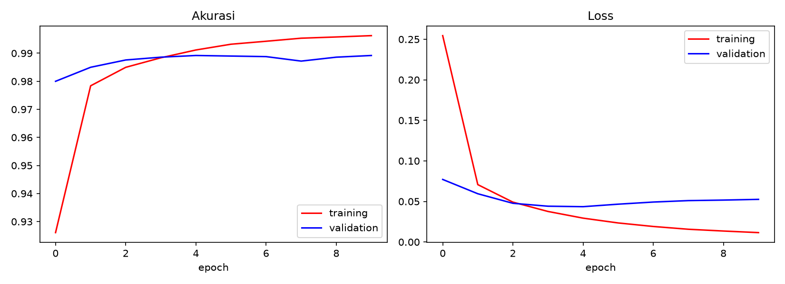
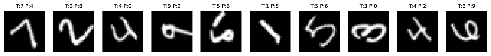

# Analisis Ketahanan CNN terhadap Noise, Blur, dan Rotasi pada Citra Angka Tulisan Tangan

**Nama:** Rachmat Mukti Ilyas  
**NIM:** 101022330200  
**Mata Kuliah:** Desain SoC dan FPGA

Repositori ini berisi implementasi *end-to-end* Convolutional Neural Network (CNN) untuk pengenalan angka tulisan tangan **MNIST**, beserta analisis **ketahanan (*robustness*)** model terhadap tiga jenis gangguan citra: ***Gaussian noise***, ***Gaussian blur***, dan **rotasi**. Dua model dibandingkan: model **baseline** (dilatih pada data bersih) dan model **beraugmentasi** (dilatih pada data bersih ditambah data bergangguan).

---

## 1. Latar Belakang & Dataset

Model pengenalan angka tulisan tangan umumnya dilatih dan dievaluasi pada citra yang bersih. Pada penggunaan nyata, citra dapat terganggu oleh kualitas sensor atau kamera (*noise*), fokus yang kurang tajam (*blur*), dan posisi kertas yang miring (rotasi). Karena itu akurasi pada data bersih saja belum cukup untuk menilai seberapa andal sebuah model. Proyek ini mengukur seberapa besar akurasi CNN turun ketika citra diganggu secara bertahap, dan apakah augmentasi data latih dapat memperbaiki ketahanannya.

- **Dataset:** MNIST Handwritten Digits (dimuat otomatis melalui `tf.keras.datasets.mnist.load_data()`)
- **Citra:** 28 × 28 piksel, 1 channel (*grayscale*), 10 kelas (angka 0-9), label *one-hot encoded*
- **Pembagian Data:**

| Bagian | Jumlah Citra | Keterangan |
|---|---|---|
| Training | 55.000 | Melatih model |
| Validation | 5.000 | Memantau overfitting saat training |
| Test | 10.000 | Evaluasi akhir dan dasar pembuatan data bergangguan |

### Dataset Uji Bergangguan

Gangguan hanya diterapkan pada **data test (10.000 citra)**. Label tidak berubah, karena gangguan tidak mengubah angka yang sebenarnya. Dataset dibuat dengan `python/generate_datasets.py` dan fungsi gangguannya ada di `python/perturbations.py`.

| Gangguan | Parameter | Level Pengujian |
|---|---|---|
| Gaussian noise | σ | 0, 0,1, 0,2, 0,3, 0,5 |
| Gaussian blur | σ | 0, 0,5, 1,0, 1,5, 2,0 |
| Rotasi | sudut (derajat) | −45, −30, −15, 0, 15, 30, 45 |

Level `0` pada setiap jenis gangguan adalah data asli, yang dipakai sebagai titik pembanding (*baseline*).


---

## 2. Arsitektur Jaringan

Arsitektur mengikuti referensi dari slide dosen (Aplikasi CNN pada Pengenalan Angka, Informatika ITS). Kedua model (baseline dan beraugmentasi) memakai arsitektur dan hyperparameter yang **sama persis**, sehingga satu-satunya perbedaan ada pada data latihnya.

| Layer | Konfigurasi | Dimensi Output | Jumlah Parameter |
|---|---|---|---|
| **Input** | Grayscale 1-channel | `28 × 28 × 1` | - |
| **Conv1** | 16 filter `3×3`, ReLU, padding `same` | `28 × 28 × 16` | 160 |
| **MaxPool1** | `2×2` | `14 × 14 × 16` | 0 |
| **Conv2** | 32 filter `3×3`, ReLU, padding `same` | `14 × 14 × 32` | 4.640 |
| **MaxPool2** | `2×2` | `7 × 7 × 32` | 0 |
| **Flatten** | - | `1568` | 0 |
| **Dense1** | 64 neuron, ReLU | `64` | 100.416 |
| **Dense2 (Output)** | 10 neuron, Softmax | `10` | 650 |
| **Total** | - | - | **105.866** |

**Konfigurasi training:**

| Parameter | Nilai |
|---|---|
| Optimizer | Adam |
| Loss | `categorical_crossentropy` |
| Metrik | Akurasi |
| Epochs | 10 |
| Batch size | 100 |
| Data validasi | 5.000 citra bersih |

**Model beraugmentasi:** data latih bersih (55.000) ditambah salinan yang diberi gangguan, masing-masing 6.000 citra acak per level.

| Gangguan augmentasi | Level | Tambahan Citra |
|---|---|---|
| Gaussian noise | σ = 0,1, 0,3, 0,5 | 18.000 |
| Gaussian blur | σ = 0,5, 1,0, 1,5 | 18.000 |
| Rotasi | −30°, −15°, 15°, 30° | 24.000 |
| **Total data latih** | | **115.000** |

Label citra bergangguan sama dengan label citra aslinya. Data validasi dan data test tidak ikut diaugmentasi.

---

## 3. Metode Pengujian Ketahanan

1. Latih model **baseline** pada 55.000 citra bersih (`train_cnn_mnist.ipynb`).
2. Latih model **beraugmentasi** pada 115.000 citra (`train_cnn_augmented.ipynb`).
3. Buat dataset uji bergangguan dari 10.000 citra test (`generate_datasets.py`).
4. Hitung akurasi kedua model pada setiap jenis dan level gangguan (`robustness_test.ipynb`).
5. Analisis penurunan akurasi, akurasi per digit, *confusion matrix*, dan contoh prediksi salah.

Level rotasi ±45° dan noise σ = 0,2 **tidak** dipakai saat augmentasi, sehingga menjadi uji generalisasi ke gangguan yang belum pernah dilihat model.

---

## 4. Struktur Repositori

```
CNN_Robustness_MNIST/
├── dataset/                    # Informasi dataset & contoh citra gangguan
│   ├── samples/                # Contoh citra asli vs noise, blur, rotasi
│   │   └── contoh_gangguan.png
│   └── README.md               # Penjelasan dataset & cara membuat dataset bergangguan
├── python/                     # Tahap Software: training, gangguan, & pengujian
│   ├── perturbations.py        # Fungsi Gaussian noise, blur, & rotasi
│   ├── generate_datasets.py    # Pembuat dataset uji bergangguan (.npz)
│   ├── train_cnn_mnist.ipynb   # Training model baseline
│   ├── train_cnn_augmented.ipynb  # Training model beraugmentasi
│   ├── robustness_test.ipynb   # Pengujian ketahanan & perbandingan kedua model
│   ├── model_cnn_mnist.keras   # Bobot model baseline
│   ├── model_cnn_augmented.keras  # Bobot model beraugmentasi
│   └── requirements.txt        # Daftar library Python
├── verilog/                    # Tahap RTL (tidak digunakan pada tugas ini)
│   └── README.md
├── report/                     # Laporan, grafik, & hasil pengujian
│   ├── figures/                # Grafik training, akurasi, confusion matrix
│   ├── laporan_UTS.pdf         # Laporan proyek
│   └── README.md
├── .gitignore                  # Mengabaikan .venv, cache, & dataset hasil generate (.npz)
└── README.md                   # Laporan utama proyek
```

---

## 5. Hasil Pengujian & Evaluasi

### 5.1 Performa pada Data Bersih

Pengujian pada 10.000 citra test tanpa gangguan:

| Model | Akurasi Test | Loss Test | Keterangan |
|---|---|---|---|
| **Baseline** | **98,74%** | 0.0431 | Dilatih pada 55.000 citra bersih |
| **Beraugmentasi** | **99,10%** | 0.0451 | Dilatih pada 115.000 citra (bersih + bergangguan) |



### 5.2 Akurasi terhadap Gaussian Noise

| σ noise | 0 | 0,1 | 0,2 | 0,3 | 0,5 |
|---|---|---|---|---|---|
| **Baseline** | 98,74% | 98,49% | 97,81% | 94,36% | 62,87% |
| **Beraugmentasi** | 99,10% | 99,06% | 98,81% | 98,08% | 92,56% |

### 5.3 Akurasi terhadap Gaussian Blur

| σ blur | 0 | 0,5 | 1,0 | 1,5 | 2,0 |
|---|---|---|---|---|---|
| **Baseline** | 98,74% | 98,68% | 98,30% | 96,67% | 92,26% |
| **Beraugmentasi** | 99,10% | 99,06% | 98,78% | 98,03% | 96,32% |

### 5.4 Akurasi terhadap Rotasi

| Sudut | −45° | −30° | −15° | 0° | 15° | 30° | 45° |
|---|---|---|---|---|---|---|---|
| **Baseline** | 46,35% | 77,95% | 95,89% | 98,74% | 96,67% | 82,99% | 54,80% |
| **Beraugmentasi** | 86,67% | 96,51% | 98,60% | 99,10% | 98,43% | 96,14% | 87,25% |

### 5.5 Grafik Perbandingan

Akurasi per digit pada rotasi +45° (10.000 citra test):

| Digit | 0 | 1 | 2 | 3 | 4 | 5 | 6 | 7 | 8 | 9 |
|---|---|---|---|---|---|---|---|---|---|---|
| **Baseline** | 94,69% | 60,26% | 50,00% | 42,77% | 26,48% | 44,73% | 80,58% | 15,08% | 50,00% | 83,94% |
| **Beraugmentasi** | 98,78% | 97,36% | 81,69% | 90,30% | 75,36% | 88,12% | 87,79% | 83,46% | 73,61% | 94,65% |
| Selisih (poin) | +4,09 | +37,10 | +31,69 | +47,53 | +48,88 | +43,39 | +7,21 | +68,38 | +23,61 | +10,71 |




---

## 6. Analisis

1. **Gangguan paling merusak: rotasi.** Pada baseline, akurasi turun dari 98,74% (data bersih) menjadi 46,35% pada rotasi −45° (turun 52,39 poin) dan 54,80% pada +45° (turun 43,94 poin). Noise σ = 0,5 menurunkan akurasi menjadi 62,87% (turun 35,87 poin), sedangkan blur σ = 2,0 hanya menurunkannya menjadi 92,26% (turun 6,48 poin). Urutan dari yang paling merusak adalah rotasi, noise, lalu blur. Perbandingan ini dilakukan pada level terberat yang diuji, dan satuan level tiap gangguan berbeda, sehingga bukan perbandingan pada intensitas yang setara. Model baseline hanya melihat digit tegak saat training, dan *max pooling* hanya memberi toleransi terhadap pergeseran kecil, bukan rotasi. Akurasi pada −45° juga 8,45 poin lebih rendah daripada pada +45°, sehingga arah rotasi memengaruhi hasil.
2. **Titik penurunan tajam:** [isi: level noise, blur, dan rotasi tempat akurasi baseline mulai turun lebih dari 5 poin, dari tabel 5.2 sampai 5.4].
3. **Digit paling rentan:** Pada rotasi +45°, baseline paling lemah pada digit **7** (15,08%) dan **4** (26,48%), lalu digit 3 (42,77%) dan 5 (44,73%). Digit **0** paling stabil (94,69%), kemungkinan karena bentuknya mendekati simetris terhadap rotasi. Pada model beraugmentasi, digit terlemah menjadi **8** (73,61%) dan **4** (75,36%), dan semua digit berada di atas 73%. Digit 4 tetap termasuk yang paling rentan pada kedua model. [isi: pasangan digit yang paling sering tertukar, dari `confusion_rot45.png`].
4. **Efek augmentasi: sangat membantu.** Pada level terberat, akurasi naik dari 62,87% menjadi 92,56% untuk noise σ = 0,5 (+29,69 poin), dari 92,26% menjadi 96,32% untuk blur σ = 2,0 (+4,06 poin), dan dari 46,35% / 54,80% menjadi 86,67% / 87,25% untuk rotasi −45° / +45° (+40,32 / +32,45 poin). Akurasi pada data bersih tidak turun, melainkan naik tipis dari 98,74% menjadi 99,10% (+0,36 poin). Pada rotasi +45°, peningkatan terbesar ada pada digit 7 (+68,38 poin), 4 (+48,88 poin), dan 3 (+47,53 poin).
5. **Generalisasi ke level yang belum dilihat:** Rotasi ±45° tidak dipakai saat augmentasi (hanya ±15° dan ±30°), namun akurasi model beraugmentasi tetap 86,67% dan 87,25%, jauh di atas baseline. Blur σ = 2,0 juga di luar rentang augmentasi (maksimum σ = 1,5) dan tetap mencapai 96,32%. Namun model beraugmentasi belum sepenuhnya tahan: pada noise σ = 0,5 (yang termasuk level augmentasi) akurasinya masih 6,54 poin di bawah data bersih, dan pada rotasi ±45° masih sekitar 12 poin di bawahnya. [isi: hasil noise σ = 0,2 dari tabel 5.2].
6. **Keterbatasan:** gangguan bersifat sintetis (bukan noise sensor nyata), hanya satu arsitektur CNN kecil yang diuji, hanya satu dataset (MNIST), dan hasil berasal dari satu kali training tanpa pengulangan dengan *seed* berbeda, sehingga selisih kecil (seperti +0,36 poin pada data bersih) belum tentu signifikan.

---

## 7. Kesimpulan

CNN baseline mencapai akurasi 98,74% pada data bersih, tetapi ketahanannya berbeda untuk tiap gangguan. Rotasi ±45° paling merusak (akurasi turun menjadi 46,35% dan 54,80%), diikuti noise σ = 0,5 (62,87%), sedangkan blur σ = 2,0 paling ringan dampaknya (92,26%). Melatih model dengan data bergangguan terbukti efektif: akurasi pada level terberat naik menjadi 92,56% (noise), 96,32% (blur), dan 86,67% / 87,25% (rotasi ±45°), tanpa mengorbankan akurasi data bersih (99,10%). Augmentasi juga meningkatkan ketahanan pada level yang tidak dipakai saat training, tetapi model belum sepenuhnya kebal terhadap gangguan berat, sehingga augmentasi yang lebih luas atau arsitektur yang lebih besar dapat menjadi pengembangan lanjutan.

---

## 8. Cara Menjalankan

> Gunakan Python 3.11 atau 3.12 (TensorFlow hanya mendukung versi Python tertentu; cek tensorflow.org/install/pip untuk versi terbaru).

### A. Clone Repositori dan Pasang Library

```bash
git clone https://github.com/Ijaz2k/CNN_Robustness_MNIST.git
cd CNN_Robustness_MNIST
python -m venv .venv
.venv\Scripts\activate          # Windows
pip install -r python/requirements.txt
```

### B. Buat Dataset Uji Bergangguan

```bash
python python/generate_datasets.py
```

File `.npz` akan tersimpan di `dataset/perturbed/` (tidak di-upload ke GitHub karena bisa dibuat ulang).

### C. Latih Model

Jalankan notebook berikut berurutan (pilih kernel `.venv`):

1. `python/train_cnn_mnist.ipynb` untuk model baseline
2. `python/train_cnn_augmented.ipynb` untuk model beraugmentasi

### D. Uji Ketahanan

Jalankan `python/robustness_test.ipynb`. Grafik hasil tersimpan di `report/figures/`.
