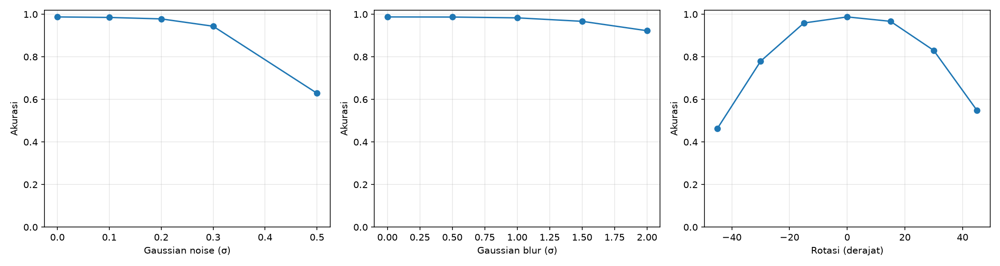
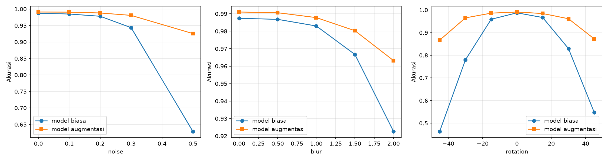
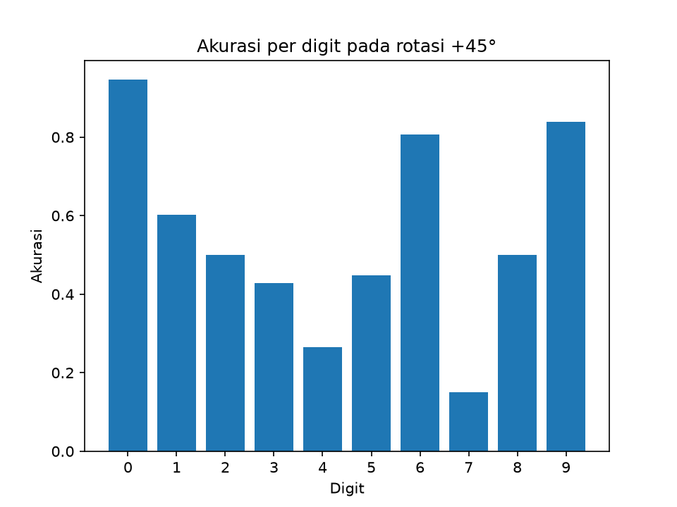
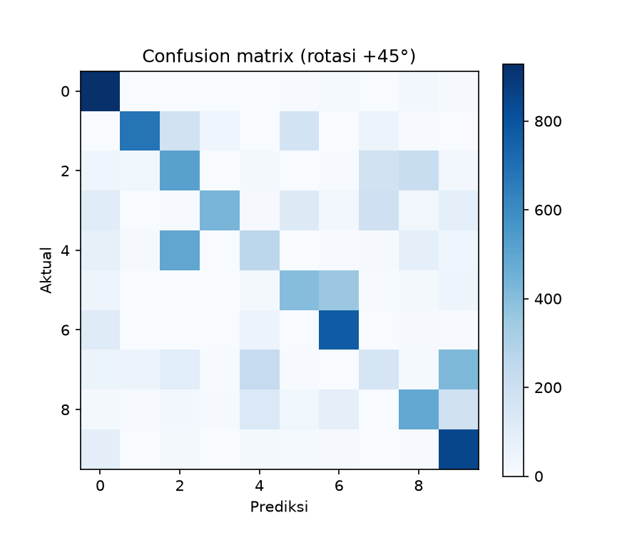

# Analisis Ketahanan CNN terhadap Noise, Blur, dan Rotasi pada Citra Angka Tulisan Tangan

**Nama:** Rachmat Mukti Ilyas  
**NIM:** 101022330200  
**Mata Kuliah:** Desain SoC dan FPGA

Repositori ini berisi implementasi *end-to-end* Convolutional Neural Network (CNN) untuk pengenalan angka tulisan tangan **MNIST**, beserta analisis **ketahanan (*robustness*)** model terhadap tiga jenis gangguan citra: ***Gaussian noise***, ***Gaussian blur***, dan **rotasi**. Dua model dibandingkan: model **baseline** (dilatih pada data bersih) dan model **beraugmentasi** (dilatih pada data bersih ditambah data bergangguan).

---

## 1. Latar Belakang & Dataset

Model pengenalan angka tulisan tangan umumnya dilatih dan dievaluasi pada citra yang bersih. Pada penggunaan nyata, citra dapat terganggu oleh kualitas sensor atau kamera (*noise*), fokus yang kurang tajam (*blur*), dan posisi kertas yang miring (rotasi). Karena itu akurasi pada data bersih saja belum cukup untuk menilai seberapa andal sebuah model. Proyek ini mengukur seberapa besar akurasi CNN turun ketika citra diganggu secara bertahap, dan apakah augmentasi data latih dapat memperbaiki ketahanannya.

- **Dataset:** MNIST Handwritten Digits (dimuat otomatis melalui `tf.keras.datasets.mnist.load_data()`)
- **Citra:** 28 × 28 piksel, 1 channel (*grayscale*), 10 kelas (angka 0-9), label *one-hot encoded*
- **Pembagian Data:**

| Bagian | Jumlah Citra | Keterangan |
|---|---|---|
| Training | 55.000 | Melatih model |
| Validation | 5.000 | Memantau overfitting saat training |
| Test | 10.000 | Evaluasi akhir dan dasar pembuatan data bergangguan |

### Dataset Uji Bergangguan

Gangguan hanya diterapkan pada **data test (10.000 citra)**. Label tidak berubah, karena gangguan tidak mengubah angka yang sebenarnya. Dataset dibuat dengan `python/generate_datasets.py` dan fungsi gangguannya ada di `python/perturbations.py`.

| Gangguan | Parameter | Level Pengujian |
|---|---|---|
| Gaussian noise | σ | 0, 0,1, 0,2, 0,3, 0,5 |
| Gaussian blur | σ | 0, 0,5, 1,0, 1,5, 2,0 |
| Rotasi | sudut (derajat) | −45, −30, −15, 0, 15, 30, 45 |

Level `0` pada setiap jenis gangguan adalah data asli, yang dipakai sebagai titik pembanding (*baseline*).


---

## 2. Arsitektur Jaringan

Arsitektur mengikuti referensi dari slide dosen (Aplikasi CNN pada Pengenalan Angka, Informatika ITS). Kedua model (baseline dan beraugmentasi) memakai arsitektur dan hyperparameter yang **sama persis**, sehingga satu-satunya perbedaan ada pada data latihnya.

| Layer | Konfigurasi | Dimensi Output | Jumlah Parameter |
|---|---|---|---|
| **Input** | Grayscale 1-channel | `28 × 28 × 1` | - |
| **Conv1** | 16 filter `3×3`, ReLU, padding `same` | `28 × 28 × 16` | 160 |
| **MaxPool1** | `2×2` | `14 × 14 × 16` | 0 |
| **Conv2** | 32 filter `3×3`, ReLU, padding `same` | `14 × 14 × 32` | 4.640 |
| **MaxPool2** | `2×2` | `7 × 7 × 32` | 0 |
| **Flatten** | - | `1568` | 0 |
| **Dense1** | 64 neuron, ReLU | `64` | 100.416 |
| **Dense2 (Output)** | 10 neuron, Softmax | `10` | 650 |
| **Total** | - | - | **105.866** |

**Konfigurasi training:**

| Parameter | Nilai |
|---|---|
| Optimizer | Adam |
| Loss | `categorical_crossentropy` |
| Metrik | Akurasi |
| Epochs | 10 |
| Batch size | 100 |
| Data validasi | 5.000 citra bersih |

**Model beraugmentasi:** data latih bersih (55.000) ditambah salinan yang diberi gangguan, masing-masing 6.000 citra acak per level.

| Gangguan augmentasi | Level | Tambahan Citra |
|---|---|---|
| Gaussian noise | σ = 0,1, 0,3, 0,5 | 18.000 |
| Gaussian blur | σ = 0,5, 1,0, 1,5 | 18.000 |
| Rotasi | −30°, −15°, 15°, 30° | 24.000 |
| **Total data latih** | | **115.000** |

Label citra bergangguan sama dengan label citra aslinya. Data validasi dan data test tidak ikut diaugmentasi.

---

## 3. Metode Pengujian Ketahanan

1. Latih model **baseline** pada 55.000 citra bersih (`train_cnn_mnist.ipynb`).
2. Latih model **beraugmentasi** pada 115.000 citra (`train_cnn_augmented.ipynb`).
3. Buat dataset uji bergangguan dari 10.000 citra test (`generate_datasets.py`).
4. Hitung akurasi kedua model pada setiap jenis dan level gangguan (`robustness_test.ipynb`).
5. Analisis penurunan akurasi, akurasi per digit, *confusion matrix*, dan contoh prediksi salah.

Level rotasi ±45° dan noise σ = 0,2 **tidak** dipakai saat augmentasi, sehingga menjadi uji generalisasi ke gangguan yang belum pernah dilihat model.

---

## 4. Struktur Repositori

```
CNN_Robustness_MNIST/
├── dataset/                    # Informasi dataset & contoh citra gangguan
│   ├── samples/                # Contoh citra asli vs noise, blur, rotasi
│   │   └── contoh_gangguan.png
│   └── README.md               # Penjelasan dataset & cara membuat dataset bergangguan
├── python/                     # Tahap Software: training, gangguan, & pengujian
│   ├── perturbations.py        # Fungsi Gaussian noise, blur, & rotasi
│   ├── generate_datasets.py    # Pembuat dataset uji bergangguan (.npz)
│   ├── train_cnn_mnist.ipynb   # Training model baseline
│   ├── train_cnn_augmented.ipynb  # Training model beraugmentasi
│   ├── robustness_test.ipynb   # Pengujian ketahanan & perbandingan kedua model
│   ├── model_cnn_mnist.keras   # Bobot model baseline
│   ├── model_cnn_augmented.keras  # Bobot model beraugmentasi
│   └── requirements.txt        # Daftar library Python
├── verilog/                    # Tahap RTL (tidak digunakan pada tugas ini)
│   └── README.md
├── report/                     # Laporan, grafik, & hasil pengujian
│   ├── figures/                # Grafik training, akurasi, confusion matrix
│   ├── laporan_UTS.pdf         # Laporan proyek
│   └── README.md
├── .gitignore                  # Mengabaikan .venv, cache, & dataset hasil generate (.npz)
└── README.md                   # Laporan utama proyek
```

---

## 5. Hasil Pengujian & Evaluasi

### 5.1 Performa pada Data Bersih

Pengujian pada 10.000 citra test tanpa gangguan:

| Model | Akurasi Test | Loss Test | Keterangan |
|---|---|---|---|
| **Baseline** | **XX,XX%** | X,XXXX | Dilatih pada 55.000 citra bersih |
| **Beraugmentasi** | **XX,XX%** | X,XXXX | Dilatih pada 115.000 citra (bersih + bergangguan) |


### 5.2 Akurasi terhadap Gaussian Noise

| σ noise | 0 | 0,1 | 0,2 | 0,3 | 0,5 |
|---|---|---|---|---|---|
| **Baseline** | XX,XX% | XX,XX% | XX,XX% | XX,XX% | XX,XX% |
| **Beraugmentasi** | XX,XX% | XX,XX% | XX,XX% | XX,XX% | XX,XX% |

### 5.3 Akurasi terhadap Gaussian Blur

| σ blur | 0 | 0,5 | 1,0 | 1,5 | 2,0 |
|---|---|---|---|---|---|
| **Baseline** | XX,XX% | XX,XX% | XX,XX% | XX,XX% | XX,XX% |
| **Beraugmentasi** | XX,XX% | XX,XX% | XX,XX% | XX,XX% | XX,XX% |

### 5.4 Akurasi terhadap Rotasi

| Sudut | −45° | −30° | −15° | 0° | 15° | 30° | 45° |
|---|---|---|---|---|---|---|---|
| **Baseline** | XX,XX% | XX,XX% | XX,XX% | XX,XX% | XX,XX% | XX,XX% | XX,XX% |
| **Beraugmentasi** | XX,XX% | XX,XX% | XX,XX% | XX,XX% | XX,XX% | XX,XX% | XX,XX% |

### 5.5 Grafik Perbandingan





### 5.6 Analisis per Digit dan Kesalahan Klasifikasi

Pada rotasi +45° (gangguan paling berat untuk rotasi):






---

## 6. Analisis

1. **Gangguan paling merusak:** [isi: jenis gangguan dengan penurunan akurasi terbesar pada level terberat, sebutkan angkanya, misalnya dari XX% menjadi XX%].
2. **Titik penurunan tajam:** [isi: pada level berapa akurasi mulai turun signifikan untuk tiap gangguan].
3. **Digit paling rentan:** [isi: digit dengan akurasi terendah pada rotasi +45° dan pasangan yang sering tertukar menurut *confusion matrix*, serta alasan visualnya].
4. **Efek augmentasi:** [isi: pada gangguan apa model beraugmentasi paling membaik dan seberapa besar selisihnya; apakah akurasi pada data bersih berubah].
5. **Generalisasi ke level yang belum dilihat:** [isi: hasil pada noise σ = 0,2 dan rotasi ±45°, yang tidak dipakai saat augmentasi].
6. **Keterbatasan:** gangguan bersifat sintetis (bukan noise sensor nyata), hanya satu arsitektur CNN kecil yang diuji, dan hanya satu dataset (MNIST).

---

## 7. Kesimpulan

[isi: 3-4 kalimat yang menjawab tujuan: gangguan mana yang paling memengaruhi CNN, apakah augmentasi efektif, dan rekomendasi singkat.]

---

## 8. Cara Menjalankan

> Gunakan Python 3.11 atau 3.12 (TensorFlow hanya mendukung versi Python tertentu; cek tensorflow.org/install/pip untuk versi terbaru).

### A. Clone Repositori dan Pasang Library

```bash
git clone https://github.com/Ijaz2k/CNN_Robustness_MNIST.git
cd CNN_Robustness_MNIST
python -m venv .venv
.venv\Scripts\activate          # Windows
pip install -r python/requirements.txt
```

### B. Buat Dataset Uji Bergangguan

```bash
python python/generate_datasets.py
```

File `.npz` akan tersimpan di `dataset/perturbed/` (tidak di-upload ke GitHub karena bisa dibuat ulang).

### C. Latih Model

Jalankan notebook berikut berurutan (pilih kernel `.venv`):

1. `python/train_cnn_mnist.ipynb` untuk model baseline
2. `python/train_cnn_augmented.ipynb` untuk model beraugmentasi

### D. Uji Ketahanan

Jalankan `python/robustness_test.ipynb`. Grafik hasil tersimpan di `report/figures/`.
